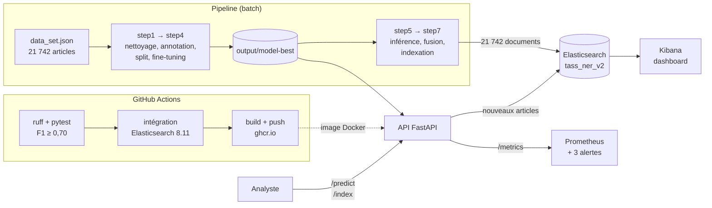

# 🎯 OSINT NER — TASS News Analysis

Projet de **reconnaissance d'entités nommées (NER)** appliqué à la couverture médiatique russe (agence **TASS**) du conflit en Ukraine. Le modèle repère automatiquement les armes, les organisations et les unités militaires citées dans plus de 21 000 articles. Les résultats sont indexés dans **Elasticsearch** et visualisés dans un dashboard **Kibana**. Le modèle est aussi mis à disposition par une **API**, testé automatiquement par une chaîne **CI/CD** et surveillé avec **Prometheus**.

---

## 📖 Table des matières

- [Contexte & Problématique](#-contexte--problématique)
- [Ce que fait le projet](#-ce-que-fait-le-projet)
- [Architecture](#️-architecture)
- [Stack technique](#️-stack-technique)
- [Installation et lancement](#️-installation-et-lancement)
- [Pipeline — étape par étape](#-pipeline--étape-par-étape)
- [Résultats & Métriques](#-résultats--métriques)
- [Dashboard Kibana](#-dashboard-kibana)
- [API d'inférence](#-api-dinférence)
- [CI/CD](#-cicd)
- [Monitoring](#-monitoring)
- [Mettre à jour le modèle](#-mettre-à-jour-le-modèle)
- [Captures](#-captures)
- [Limites & Améliorations](#️-limites--améliorations-possibles)
- [Structure des fichiers](#-structure-des-fichiers)
- [Équipe](#-équipe)

---

## 🧭 Contexte & Problématique

> **Comment extraire automatiquement des informations structurées sur les capacités militaires mentionnées dans la couverture médiatique russe du conflit ukrainien, et les rendre utilisables au quotidien par un analyste ?**

L'agence **TASS** publie beaucoup trop d'articles pour une lecture manuelle. TASS est aussi un média d'État : le modèle n'extrait pas « la vérité », mais **ce que la source affirme**.

---

## ✨ Ce que fait le projet

- 🧹 Nettoyage d'un corpus de **21 742 articles** (doublons, HTML, articles vides)
- ✍️ Annotation d'un échantillon de **200 articles** sur trois labels : `WEAPON`, `MIL_ORG`, `MIL_UNIT`
- 🧠 **Fine-tuning** d'un modèle spaCy (`en_core_web_sm`) sur ces annotations
- 🔎 Application du modèle à tout le corpus et calcul des co-occurrences armes ↔ organisations
- 📥 Indexation dans **Elasticsearch** et dashboard **Kibana**
- 🌐 **API FastAPI** pour analyser et indexer un nouvel article à la demande
- ✅ **CI/CD GitHub Actions** : tests, contrôle de qualité du modèle, publication d'une image Docker
- 📡 **Monitoring Prometheus** : latence, volume, dérive des données, 3 alertes

---

## 🏗️ Architecture



Le pipeline entraîne le modèle puis indexe tout le corpus. L'API sert le même modèle pour les nouveaux articles. GitHub Actions vérifie chaque modification avant de publier l'image Docker.

---

## 🛠️ Stack technique

| Composant | Rôle |
|-----------|------|
| **Python 3** | Langage du pipeline et de l'API (3.11 dans l'image Docker) |
| **spaCy** (`en_core_web_sm`) | Modèle NER fine-tuné sur les entités militaires |
| **Elasticsearch 8.11.0** | Stockage, recherche et agrégations |
| **Kibana 8.11.0** | Dashboards |
| **FastAPI + Uvicorn** | API d'inférence |
| **Docker / docker-compose** | Même environnement pour tout le monde |
| **GitHub Actions + ghcr.io** | CI/CD et publication de l'image |
| **Prometheus** | Monitoring et alertes |

---

## ⚙️ Installation et lancement

Prérequis : Git, Docker et Docker Compose (et Python 3.9 ou plus récent pour rejouer le pipeline).

### Lancer tout le projet

```bash
git clone https://github.com/Thierry-Daconceicao-Alvares/projet_ner.git
cd projet_ner
docker compose up -d --build
```

| Service | Adresse |
|---|---|
| API (documentation) | http://localhost:8000/docs |
| Elasticsearch | http://localhost:9200 |
| Kibana | http://localhost:5601 |
| Prometheus | http://localhost:9090 |

L'API est construite depuis le `Dockerfile` du dépôt. Elle peut aussi être lancée seule avec l'image publiée par la CI :

```bash
docker run -p 8000:8000 ghcr.io/thierry-daconceicao-alvares/ner-tass-api:latest
```

### Installer l'environnement Python (pour rejouer le pipeline)

```bash
python -m venv venv
source venv/bin/activate   # Windows : venv\Scripts\activate
pip install -r requirements.txt
```

> ⚠️ Le client Python `elasticsearch` doit avoir la même version que le serveur (`elasticsearch==8.11.0`, déjà fixé dans les requirements). Sinon, l'indexation échoue.

---

## 🔄 Pipeline — étape par étape

| Script | Rôle |
|--------|------|
| `step1_extract_clean.py` | Nettoie le corpus : doublons, HTML, articles vides (21 665 articles gardés) |
| `step2_spacy_annotate.py` | Annote 200 articles avec des listes de termes militaires (PhraseMatcher), des expressions régulières et une vérification du contexte |
| `step3_convert_split.py` | Sépare les annotations en entraînement (80 %) et validation (20 %), au format spaCy |
| `step4_train_model.py` | Fine-tune `en_core_web_sm` et sauvegarde `output/model-best` |
| `step5_inference.py` | Applique le modèle aux articles non annotés |
| `step6_data_merged.py` | Rattache les entités à chaque article d'origine et calcule les co-occurrences |
| `step7_elasticsearch.py` | Indexe les 21 742 documents dans Elasticsearch (`tass_ner_v2`) |

```bash
python step1_extract_clean.py
python step2_spacy_annotate.py
python step3_convert_split.py
python step4_train_model.py
python step5_inference.py
python step6_data_merged.py
python step7_elasticsearch.py
```

Les 77 articles retirés au nettoyage restent dans l'index, mais sans entité : c'est pour cela qu'on retrouve 21 742 documents. Une fois l'indexation terminée, créer la **Data View** `tass_ner_v2` dans Kibana (`Stack Management → Data Views`).

Les fichiers de données volumineux (`data_set.json`, `dataset_with_entities.json`, etc.) ne sont pas versionnés (voir `.gitignore`).

---

## 📊 Résultats & Métriques

### Modèle (jeu de validation : 41 articles)

Le pipeline a été exécuté deux fois de bout en bout pour vérifier que le résultat est stable. L'API sert le modèle du second entraînement.

| Label | Entités annotées (200 articles) | F1 — 1er entraînement | F1 — 2e entraînement (modèle servi) |
|-------|------|------|------|
| **Global** | 1 103 | 0,794 | **0,804** (précision 0,819 · rappel 0,789) |
| `MIL_ORG` | 643 | 0,852 | **0,860** |
| `WEAPON` | 433 | 0,667 | **0,674** |
| `MIL_UNIT` | 27 | 0,000 | 0,000 ⚠️ (trop peu d'exemples) |

Un point d'écart entre les deux entraînements n'est pas significatif avec 41 articles de validation : le pipeline est reproductible.

### Index utilisé par le dashboard (premier entraînement)

- **21 742** articles indexés
- **63 553** entités militaires extraites (≈ 2,9 par article) : MIL_ORG 45 877, WEAPON 17 638, MIL_UNIT 37
- **87,1 %** des articles contiennent au moins une entité
- **1 059** formulations d'armes distinctes
- Armes les plus citées : **cruise missiles** (1 034), **Kalibr** (735), **S-400** (680), **ballistic missiles** (679)
- Co-occurrences fortes : `Kalibr × Russian Navy` (258), `S-400 × NATO` (244), `ballistic missiles × NATO` (204)

Le second entraînement donne des résultats très proches (≈ 62 500 entités, 86,6 % de couverture, mêmes co-occurrences). Les rapports bruts sont dans [`reports/`](reports/).

---

## 📈 Dashboard Kibana

Le dashboard regroupe :

1. **Top 10 armes citées** — domination des missiles de croisière et des systèmes de défense antiaérienne
2. **Heatmap Armes × Organisations militaires** — associations distinctes (HIMARS ↔ ministère russe de la Défense, cruise missiles ↔ NATO)
3. **Donut des armes par organisation** — le « profil d'armement » de chaque acteur
4. **KPI** — articles indexés, entités extraites, formulations d'armes distinctes

> Le dashboard va au-delà d'un simple comptage : il montre quelles armes TASS associe à quels acteurs.

---

## 🌐 API d'inférence

Code : [`api/main.py`](api/main.py). L'API charge le modèle spaCy une seule fois au démarrage. Pydantic vérifie les entrées : un texte vide ou trop long est refusé avec une erreur 422.

| Méthode | Route | Rôle |
|---|---|---|
| GET | `/health` | État du service, labels, connexion à Elasticsearch |
| GET | `/model/info` | Modèle servi : précision, rappel et F1, global et par label |
| POST | `/predict` | Entités d'un article (texte, label, position), comptes, listes sans doublon |
| POST | `/predict/batch` | Même chose pour 1 à 100 articles |
| POST | `/index` | Analyse l'article puis l'indexe dans `tass_ner_v2` (erreur 503 si Elasticsearch est absent) |
| GET | `/metrics` | Métriques lues par Prometheus |
| GET | `/docs` | Documentation interactive (Swagger UI, servie par l'API, sans accès à Internet) |

```bash
pip install -r requirements-api.txt
uvicorn api.main:app --port 8000

curl -X POST localhost:8000/predict -H 'Content-Type: application/json' \
  -d '{"text": "The Russian Defense Ministry said S-400 systems shot down a HIMARS rocket."}'
```

Pour qu'un article apparaisse dans le dashboard, l'envoyer à `/index` avec un identifiant et une date en secondes : l'API la convertit en millisecondes pour Elasticsearch.

| Variable | Défaut | Rôle |
|---|---|---|
| `MODEL_PATH` | `output/model-best` | Dossier du modèle servi |
| `ES_URL` | (vide) | Adresse d'Elasticsearch ; sans elle, `/index` répond 503 |
| `ES_INDEX` | `tass_ner_v2` | Index cible |
| `MAX_CHARS` | `100000` | Longueur maximale acceptée pour un article |

---

## ✅ CI/CD

Le fichier [`.github/workflows/ci.yml`](.github/workflows/ci.yml) contient trois jobs. Un job ne démarre que si le précédent a réussi.

| Job | Quand | Ce qu'il fait |
|---|---|---|
| `tests` | push sur `main`, pull request | `ruff` (lint), puis `pytest` : 7 tests d'API et le contrôle de qualité du modèle |
| `integration` | après `tests` | Démarre un vrai Elasticsearch 8.11, indexe 50 articles du corpus via `POST /index`, vérifie le nombre de documents et une agrégation sur les armes |
| `docker` | push sur `main` uniquement | Construit l'image, la publie sur ghcr.io (étiquettes `latest` et SHA du commit), puis la démarre pour un test de fumée (`/health`, `/predict`) |

**Le contrôle de qualité (« garde-fou »).** Le test [`tests/test_model_quality.py`](tests/test_model_quality.py) évalue le modèle du dépôt sur le jeu de validation de référence `data/dev.spacy` et échoue si le F1 global est inférieur à 0,70 (variable `F1_MIN`). Dans ce cas, aucune image n'est publiée. C'est un seuil minimum : il bloque un modèle vraiment mauvais, pas une petite baisse.

---

## 📡 Monitoring

L'API expose ses métriques sur `/metrics`. Prometheus les lit toutes les 5 secondes ([`monitoring/prometheus.yml`](monitoring/prometheus.yml)).

| Métrique | Question à laquelle elle répond |
|---|---|
| `ner_api_requests_total{endpoint, status}` | Combien de requêtes, sur quelles routes, avec quelles erreurs ? |
| `ner_api_request_latency_seconds{endpoint}` | Le service répond-il assez vite ? |
| `ner_entities_total{label}` | Combien d'entités de chaque type sont trouvées ? |
| `ner_articles_total`, `ner_articles_without_entity_total` | Quelle part des articles n'a aucune entité ? |
| `ner_article_chars`, `ner_model_f1{label}` | Taille des articles reçus, qualité du modèle servi |

| Alerte ([`monitoring/alerts.yml`](monitoring/alerts.yml)) | Condition | Ce qu'elle signale |
|---|---|---|
| `ApiIndisponible` | l'API ne répond plus pendant 1 min | le service est tombé |
| `LatenceElevee` | p95 de `/predict` > 1 s pendant 5 min | le service ralentit |
| `DeriveCouverture` | plus de 25 % d'articles sans entité (mesuré sur 30 min, pendant 15 min) | les articles reçus ne ressemblent plus au corpus (référence : 13,4 %) |

La dernière alerte est propre au NER : un modèle peut répondre vite et sans erreur tout en devenant inutile, par exemple si on lui envoie des articles d'une autre rubrique ou dans une autre langue.

Pour tester, le script [`scripts/replay_traffic.py`](scripts/replay_traffic.py) renvoie des articles du corpus vers `/predict` :

```bash
python scripts/replay_traffic.py --api http://localhost:8000 --corpus texts_clean.json --n 1000 --rate 20
```

Requêtes utiles dans Prometheus (onglet Graph) :

```
histogram_quantile(0.95, sum(rate(ner_api_request_latency_seconds_bucket{endpoint="/predict"}[5m])) by (le))
sum(rate(ner_articles_without_entity_total[30m])) / sum(rate(ner_articles_total[30m]))
```

Lors d'un test de 3 904 articles : latence p95 ≈ 47 ms, 13,2 % d'articles sans entité, aucune alerte déclenchée.

---

## 🔁 Mettre à jour le modèle

1. Ajouter ou corriger des annotations. Les 41 articles de `data/dev.spacy` forment le jeu de validation de référence : ils ne doivent jamais servir à l'entraînement, sinon le score est faussé.
2. Relancer `step3_convert_split.py` et `step4_train_model.py` pour obtenir un nouveau `output/model-best`.
3. Lancer `pytest` en local : le nouveau modèle est évalué sur `data/dev.spacy`, qui ne change pas. Comparer aussi son F1 à celui du modèle en place (`/model/info`).
4. Pousser sur une branche et ouvrir une pull request : la CI rejoue les tests et l'intégration.
5. Fusionner sur `main` : la CI publie la nouvelle image (SHA du commit + `latest`).
6. Redéployer : `git pull` puis `docker compose up -d --build` (ou `docker pull` de la nouvelle image si l'API tourne seule). En cas de problème, relancer l'image du commit précédent.

---

## 📸 Captures

| API (Swagger) | CI/CD (run GitHub Actions 43297927533) |
|---|---|
|  |  |

| Latence p95 de `/predict` (Prometheus) | Part d'articles sans entité (Prometheus) |
|---|---|
|  |  |

---

## ⚠️ Limites & Améliorations possibles

- **MIL_UNIT n'est pas appris** : 27 exemples annotés seulement. Piste : annoter davantage d'unités, par exemple avec une pré-annotation par LLM relue à la main.
- **Variantes d'une même entité comptées à part** (« Defense » et « the Russian Defense Ministry »). Piste : ajouter une étape de normalisation (synonymes, coréférence).
- **Jeu de validation petit** (41 articles) et tiré au hasard par `step3`. Piste : l'agrandir et le figer (liste d'identifiants).
- **Contrôle de qualité minimal** : seuil absolu de 0,70. Piste : comparer aussi chaque nouveau modèle au modèle en place.
- **Exploitation** : API sans authentification, alertes non envoyées. Pistes : clé d'API, Alertmanager, Grafana, hébergement cloud.
- **Source unique** : le corpus ne contient que TASS. Piste : comparer avec des médias occidentaux ou ukrainiens.

---

## 📂 Structure des fichiers

```
projet_ner/
├── step1_extract_clean.py ... step7_elasticsearch.py   # Pipeline (7 étapes)
├── output/model-best/                 # Modèle spaCy servi par l'API
├── api/
│   ├── main.py                        # API FastAPI
│   └── static/                        # Fichiers de Swagger UI (servis en local)
├── tests/
│   ├── test_api.py                    # 7 tests d'API
│   └── test_model_quality.py          # Contrôle de qualité du modèle (F1 ≥ 0,70)
├── data/
│   ├── dev.spacy                      # Jeu de validation de référence (41 articles)
│   └── sample_articles.json           # 50 articles pour le test d'intégration
├── monitoring/
│   ├── prometheus.yml                 # Configuration de Prometheus
│   └── alerts.yml                     # 3 règles d'alerte
├── scripts/replay_traffic.py          # Rejeu d'articles pour tester le monitoring
├── reports/                           # Rapports d'annotation, d'entraînement, d'inférence et de fusion
├── docs/img/                          # Captures
├── .github/workflows/ci.yml           # CI/CD GitHub Actions
├── Dockerfile                         # Image de l'API
├── docker-compose.yml                 # Elasticsearch, Kibana, API, Prometheus
├── requirements.txt                   # Dépendances du pipeline
├── requirements-api.txt               # Dépendances de l'API
├── requirements-dev.txt               # Dépendances de test (pytest, ruff…)
└── README.md
```

---

## 👥 Équipe

- **Meriem Dhiab**
- **Shaineze Menzel**
- **Thierry Alvares**

---

*Projet réalisé dans le cadre du cursus MSc — Data Pipelines for AI / OSINT NER, 2025-2026.*
