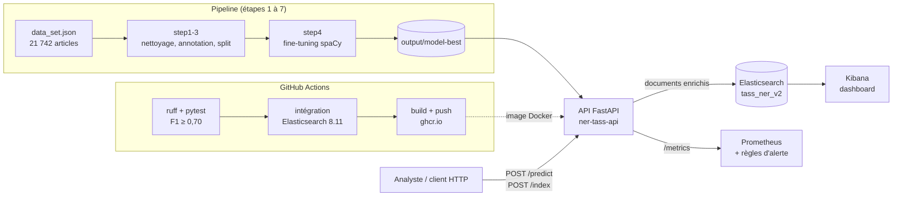
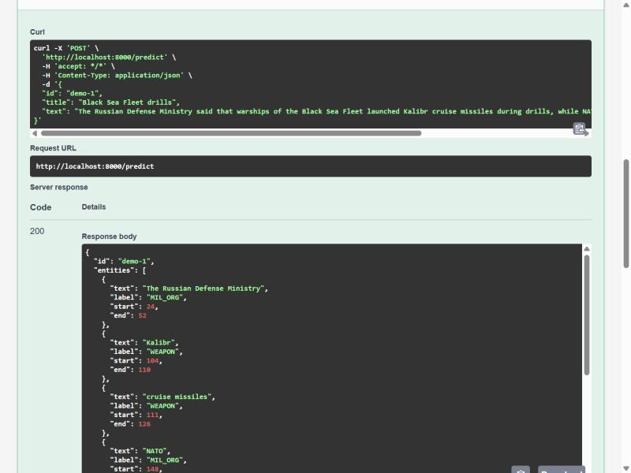
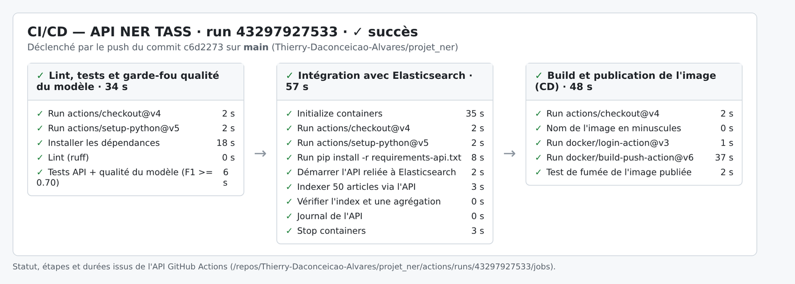
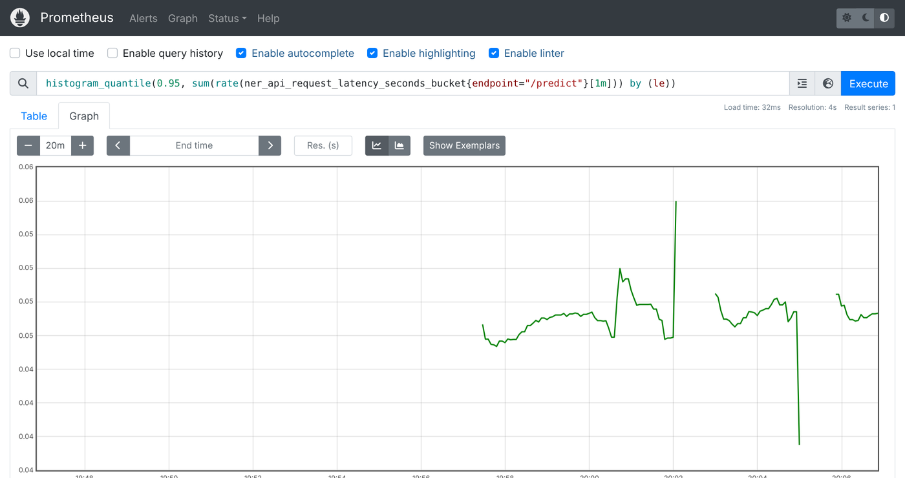
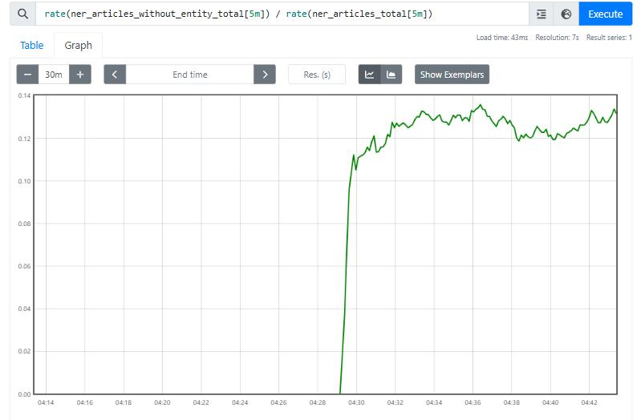

# 🎯 OSINT NER — TASS News Analysis

Pipeline complet de **Reconnaissance d'Entités Nommées (NER)** appliqué à l'analyse de la couverture médiatique russe (agence **TASS**) du conflit en Ukraine. Extraction automatique d'entités militaires (armes, organisations, unités) à partir de plus de 21 000 articles de presse, indexation dans **Elasticsearch**, et visualisation via un dashboard **Kibana**.

---

## 📖 Table des matières

- [Contexte & Problématique](#-contexte--problématique)
- [Fonctionnalités](#-fonctionnalités)
- [Architecture du projet](#-architecture-du-projet)
- [Stack technique](#-stack-technique)
- [Prérequis](#-prérequis)
- [Installation](#-installation)
- [Pipeline — étape par étape](#-pipeline--étape-par-étape)
- [Résultats & Métriques](#-résultats--métriques)
- [Dashboard Kibana](#-dashboard-kibana)
- [Limites & Améliorations](#-limites--améliorations-possibles)
- [Déploiement : API, CI/CD et monitoring](#-déploiement--api-cicd-et-monitoring)
- [Structure des fichiers](#-structure-des-fichiers)
- [Équipe](#-équipe)

---

## 🧭 Contexte & Problématique

Ce projet OSINT (*Open Source Intelligence*) vise à répondre à la question suivante :

> **Comment extraire automatiquement des informations structurées sur les capacités militaires mentionnées dans la couverture médiatique russe du conflit ukrainien ?**

L'agence de presse **TASS** publie un très grand volume d'articles impossible à dépouiller manuellement. Ce projet met en place un pipeline NLP permettant de :
1. Extraire automatiquement les entités militaires (armes, organisations, unités) de chaque article
2. Structurer ces informations dans un moteur de recherche/analyse (Elasticsearch)
3. Visualiser les tendances et corrélations via un dashboard interactif (Kibana)

---

## ✨ Fonctionnalités

- 🧹 Nettoyage et dédoublonnage d'un corpus de **21 742 articles**
- ✍️ Annotation manuelle d'un échantillon de **200 articles** (labels `WEAPON`, `MIL_ORG`, `MIL_UNIT`)
- 🧠 **Fine-tuning** d'un modèle spaCy (`en_core_web_sm`) sur les données annotées
- 🔎 Inférence NER sur l'ensemble du corpus (**63 553 entités extraites**)
- 🔗 Calcul des co-occurrences entre entités (armes ↔ organisations)
- 📥 Indexation complète dans **Elasticsearch**
- 📊 Dashboard **Kibana** : top armes citées, heatmap de corrélation Armes × Organisations, KPI clés

---

## 🏗️ Architecture du projet

```
Articles TASS bruts (JSON)
        │
        ▼
  ┌───────────────┐
  │   step1        │  Nettoyage (doublons, HTML, articles vides)
  │   clean.py     │
  └───────┬───────┘
          ▼
  ┌───────────────┐
  │  step2-4       │  Annotation manuelle (200 articles) + split train/dev
  │  annotate.py   │
  └───────┬───────┘
          ▼
  ┌───────────────┐
  │   step5        │  Fine-tuning spaCy (en_core_web_sm)
  │   finetune.py  │
  └───────┬───────┘
          ▼
  ┌───────────────┐
  │   step6        │  Inférence NER + fusion + rapport de co-occurrences
  │   merge.py     │
  └───────┬───────┘
          ▼
  ┌───────────────┐
  │   step7        │  Indexation dans Elasticsearch (index tass_ner_v2)
  │   es_index.py  │
  └───────┬───────┘
          ▼
  ┌────────────────────────────┐
  │  🐳 Docker : Elasticsearch  │
  │           + Kibana          │
  └──────────────┬─────────────┘
                 ▼
       📊 Dashboard Kibana
```

---

## 🛠️ Stack technique

| Composant | Rôle |
|-----------|------|
| **Python 3** | Langage principal du pipeline |
| **spaCy** (`en_core_web_sm`) | Modèle NER fine-tuné pour la reconnaissance d'entités militaires |
| **Elasticsearch 8.11.0** | Indexation et moteur de recherche/agrégation |
| **Kibana 8.11.0** | Visualisation et dashboards interactifs |
| **Docker / docker-compose** | Orchestration et reproductibilité de l'environnement Elasticsearch + Kibana |

---

## ✅ Prérequis

- Python ≥ 3.9
- Docker Desktop (lancé et actif)
- pip / venv (ou tout gestionnaire d'environnement Python)

---

## ⚙️ Installation

### 1. Cloner le repository

```bash
git clone <URL_DU_REPO>
cd ner-tass-osint
```

### 2. Installer les dépendances Python

```bash
python -m venv venv
source venv/bin/activate   # Windows : venv\Scripts\activate
pip install -r requirements.txt
```

> ⚠️ Vérifiez que la version du client `elasticsearch` Python correspond à la version du serveur Elasticsearch utilisée (ex : `pip install "elasticsearch==8.11.0"`), sinon des erreurs de compatibilité peuvent survenir lors de l'indexation.

### 3. Lancer Elasticsearch + Kibana avec Docker

```bash
docker compose up -d
```

Vérifiez que les services sont bien démarrés :

```bash
docker ps
```

Kibana est accessible sur : [http://localhost:5601](http://localhost:5601)
Elasticsearch est accessible sur : [http://localhost:9200](http://localhost:9200)

---

## 🔄 Pipeline — étape par étape

| Script | Commande | Description |
|--------|----------|--------------|
| `step1_clean.py` | `python step1_clean.py` | Nettoie le dataset brut (doublons, HTML, articles vides) |
| `step2-4_annotate.py` | `python step2_annotate.py` | Prépare et structure l'échantillon annoté manuellement |
| `step5_finetune.py` | `python step5_finetune.py` | Fine-tune le modèle spaCy sur les données annotées |
| `step6_merge.py` | `python step6_merge.py` | Applique le modèle sur tout le corpus, génère `dataset_with_entities.json` et le rapport de fusion |
| `step7_elasticsearch.py` | `python step7_elasticsearch.py` | Indexe les documents enrichis dans Elasticsearch (`tass_ner_v2`) |

Exécuter l'ensemble du pipeline dans l'ordre :

```bash
python step1_clean.py
python step5_finetune.py
python step6_merge.py
python step7_elasticsearch.py
```

Une fois l'indexation terminée, créez la **Data View** `tass_ner_v2` dans Kibana (`Stack Management → Data Views`) pour accéder aux visualisations.

---

## 📊 Résultats & Métriques

### Statistiques du dataset
- **21 742** articles indexés
- **63 553** entités militaires extraites (≈2,9 entités/article)
- **87,1%** des articles contiennent au moins une entité militaire détectée
- **1 059** formulations textuelles distinctes d'armes détectées

### Performance du modèle (F1-score)
| Label | F1-score | Occurrences |
|-------|----------|--------------|
| **Global** | **~79,4%** | — |
| `MIL_ORG` | ~85% | 45 877 |
| `WEAPON` | ~67% | 17 638 |
| `MIL_UNIT` | 0.000 ⚠️ | 37 (données insuffisantes) |

### Top résultats observés
- Armes les plus citées : **cruise missiles** (~1030), **S-400** (~730), **ballistic missile**, **air defense missile**
- Co-occurrences fortes : `Kalibr × Russian Navy` (258), `S-400 × NATO` (244), `ballistic missiles × NATO` (204)

---

## 📈 Dashboard Kibana

Le dashboard final regroupe :

1. **Top 10 armes citées** (Bar chart) — met en évidence la domination des missiles de croisière et systèmes de défense antiaérienne
2. **Heatmap Armes × Organisations militaires** — révèle des associations narratives distinctes (ex : HIMARS ↔ ministère russe de la Défense, cruise missiles ↔ NATO)
3. **KPI clés** — Articles indexés, Entités extraites, Taux de couverture

> Le dashboard permet d'aller au-delà d'un simple comptage : il révèle des patterns de discours et des associations sémantiques entre armes et acteurs militaires.

---

## ⚠️ Limites & Améliorations possibles

- **Déséquilibre des classes** : `MIL_UNIT` est fortement sous-représenté dans les données d'entraînement (26 exemples), ce qui explique un F1 de 0 sur ce label
- **Sur-segmentation des entités** : certaines variantes textuelles d'une même entité réelle sont comptées séparément faute de normalisation complète (ex : "Defense" vs "the Russian Defense Ministry")
- **Biais de source unique** : le corpus provient exclusivement de TASS (agence de presse officielle russe), ce qui reflète un narratif spécifique

**Pistes d'amélioration :**
- Annoter davantage d'exemples pour `MIL_UNIT`
- Ajouter une étape de normalisation/résolution de coréférence
- Étendre le corpus à d'autres sources médiatiques pour comparer les narratifs
- Automatiser le pipeline complet (orchestration via Airflow ou équivalent)

---

## 🚀 Déploiement : API, CI/CD et monitoring

Le modèle et le dashboard sont mis à disposition sous forme de service, avec intégration et livraison continues et une supervision en production.

### Pourquoi

Le pipeline produit un modèle et un dashboard à partir d'un traitement du corpus. Pour qu'un analyste OSINT puisse l'utiliser au quotidien, trois briques complètent le pipeline :

1. **Une API** pour analyser un nouvel article à la demande et l'ajouter à l'index, sans relancer le pipeline.
2. **Une chaîne CI/CD** qui vérifie le code et la qualité du modèle à chaque modification, puis publie une image Docker prête à déployer.
3. **Du monitoring** pour savoir si le service répond, s'il est rapide et si le contenu analysé dérive.

### Architecture



### Stabilité du modèle

Le pipeline a été exécuté deux fois de bout en bout (étapes 1 à 6) ; le modèle servi par l'API est celui du second entraînement.

| Mesure (jeu dev, 41 articles) | 1er entraînement | 2e entraînement (modèle servi) |
|---|---|---|
| F1 global | 0,794 | **0,804** (P 0,819 · R 0,789) |
| `MIL_ORG` | 0,852 | **0,860** |
| `WEAPON` | 0,667 | **0,674** |
| `MIL_UNIT` | 0,000 | 0,000 (27 exemples annotés seulement) |

Inférence sur le corpus complet : 21 742 articles, ≈ 62 500 entités, **86,6 %** des articles avec au moins une entité (87,1 % lors de la première exécution). Les co-occurrences principales sont identiques (`Kalibr × Russian Navy` 258, `S-400 × NATO` 244). Les rapports bruts sont dans [`reports/`](reports/).

### API d'inférence (`api/main.py`)

| Méthode | Route | Rôle |
|---|---|---|
| GET | `/health` | État du service, labels, connexion Elasticsearch |
| GET | `/model/info` | Pipeline spaCy, précision, rappel et F1 (global et par label) |
| POST | `/predict` | Entités d'un article (texte, offsets, comptes) |
| POST | `/predict/batch` | Jusqu'à 100 articles en une requête |
| POST | `/index` | Analyse puis indexe l'article dans `tass_ner_v2` (503 si Elasticsearch absent) |
| GET | `/metrics` | Métriques Prometheus |
| GET | `/docs` | Documentation interactive (Swagger UI servi localement) |

```bash
pip install -r requirements-api.txt
uvicorn api.main:app --port 8000

curl -X POST localhost:8000/predict -H 'Content-Type: application/json' \
  -d '{"text": "The Russian Defense Ministry said S-400 systems shot down a HIMARS rocket."}'
```

Variables d'environnement : `MODEL_PATH` (défaut `output/model-best`), `ES_URL`, `ES_INDEX` (défaut `tass_ner_v2`), `MAX_CHARS`, `API_VERSION`.

### Lancer toute la pile avec Docker

```bash
docker compose up -d --build
```

| Service | URL |
|---|---|
| API NER | http://localhost:8000/docs |
| Elasticsearch | http://localhost:9200 |
| Kibana | http://localhost:5601 |
| Prometheus | http://localhost:9090 |

L'image publiée par la CI peut aussi être lancée seule :

```bash
docker run -p 8000:8000 ghcr.io/thierry-daconceicao-alvares/ner-tass-api:latest
```

### CI/CD (`.github/workflows/ci.yml`)

| Job | Déclencheur | Contenu |
|---|---|---|
| `tests` | push, pull request | `ruff` (lint) puis `pytest` : 7 tests d'API et un **garde-fou qualité** qui bloque la livraison si le F1 du modèle sur `data/dev.spacy` passe sous 0,70 |
| `integration` | après `tests` | Elasticsearch 8.11 en service, indexation de 50 articles réels via `POST /index`, vérification du compte et d'une agrégation sur les armes |
| `docker` | push sur `main` | Build et publication de l'image sur GitHub Container Registry (`latest` + SHA du commit), puis test de fumée de l'image |

### Monitoring (`monitoring/`)

Métriques exposées par l'API : requêtes par route et statut, latence (histogramme), entités détectées par label, articles traités, articles sans entité, taille des articles, F1 du modèle servi.

| Alerte | Condition | Sens |
|---|---|---|
| `ApiIndisponible` | cible Prometheus injoignable pendant 1 min | le service est tombé |
| `LatenceElevee` | p95 de `/predict` > 1 s pendant 5 min | le service ralentit |
| `DeriveCouverture` | plus de 25 % d'articles sans entité sur 30 min | le contenu reçu ne ressemble plus au corpus d'entraînement (référence : ≈ 13 %) |

Pour simuler un flux d'articles et observer les tableaux Prometheus :

```bash
python scripts/replay_traffic.py --api http://localhost:8000 --corpus texts_clean.json --n 1000 --rate 20
```

### Captures

| API (Swagger) | CI/CD (run GitHub Actions 43297927533) |
|---|---|
|  |  |

| Latence p95 de `/predict` (Prometheus) | Part d'articles sans entité (Prometheus) |
|---|---|
|  |  |

### Rejouer le pipeline (noms réels des scripts)

```bash
pip install -r requirements.txt
python step1_extract_clean.py
python step2_spacy_annotate.py
python step3_convert_split.py
python step4_train_model.py
python step5_inference.py
python step6_data_merged.py
python step7_elasticsearch.py
```

Les fichiers de données volumineux (`data_set.json`, `dataset_with_entities.json`, etc.) ne sont pas versionnés (voir `.gitignore`).

---

## 📂 Structure des fichiers

```
ner-tass-osint/
├── data/
│   ├── data_set.json                  # Articles bruts
│   └── dataset_with_entities.json     # Articles enrichis après inférence NER
├── step1_clean.py                     # Nettoyage du corpus
├── step2_annotate.py                  # Préparation de l'annotation manuelle
├── step5_finetune.py                  # Fine-tuning du modèle spaCy
├── step6_merge.py                     # Inférence + fusion + rapport de co-occurrences
├── step7_elasticsearch.py             # Indexation dans Elasticsearch
├── docker-compose.yml                 # Orchestration Elasticsearch + Kibana
├── requirements.txt                   # Dépendances Python
└── README.md
```

---

## 👥 Équipe

- **Meriem Dhiab**
- **Shaineze Menzel**
- **Thierry Alvares**

---

*Projet réalisé dans le cadre du cursus MSc — Data Pipelines for AI / OSINT NER, 2025-2026.*
